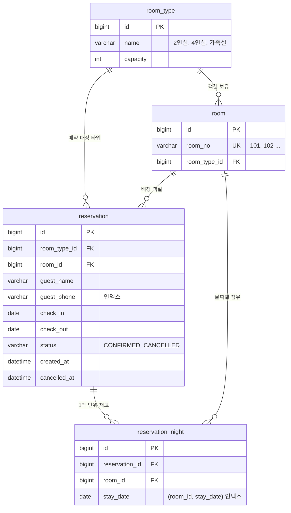

# ERD

## 설계 메모

- **사용자는 객실 타입만 고르고, 서버가 빈 객실을 배정한다.** 실무 예약 시스템과 같은 방식이고, 동시에 같은 타입을 신청하면 같은 객실이 두 번 배정될 수 있는 구조라 동시성 실험의 출발점이 된다.
- **재고는 1박 단위 행(`reservation_night`)으로 관리한다.** 2박 예약은 2행. "이 객실이 이 날짜에 찼는가"가 행 존재 여부로 결정되므로, 겹침 판정이 날짜 비교 한 번으로 끝나고 날짜별 잔여 집계도 `GROUP BY stay_date`로 끝난다.
- **체크아웃 날은 점유하지 않는다.** 11/15 체크인·11/17 체크아웃이면 15일, 16일 2행. 다음 손님이 17일에 체크인할 수 있다.
- **취소하면 `reservation_night` 행을 지운다.** 예약 이력은 `reservation.status`로 남고, 재고만 다시 열린다. 이렇게 해 두면 3주차에 `(room_id, stay_date)` 유니크 제약을 걸어도 취소된 예약이 걸림돌이 되지 않는다.
- **`(room_id, stay_date)`는 지금 일반 인덱스다.** 유니크 제약은 3주차 락 전략 비교 항목이라 일부러 비워 두었다.
